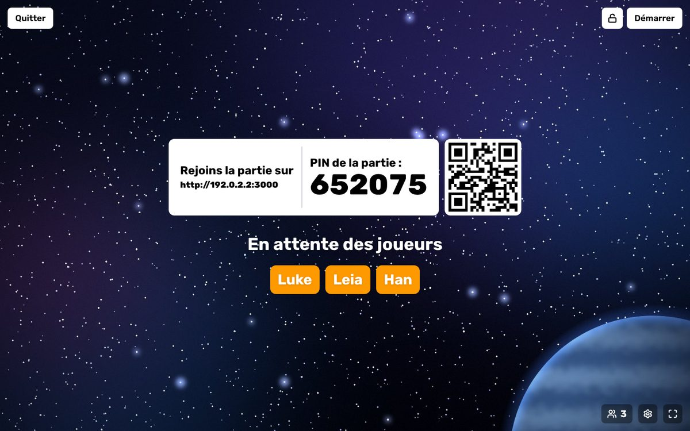
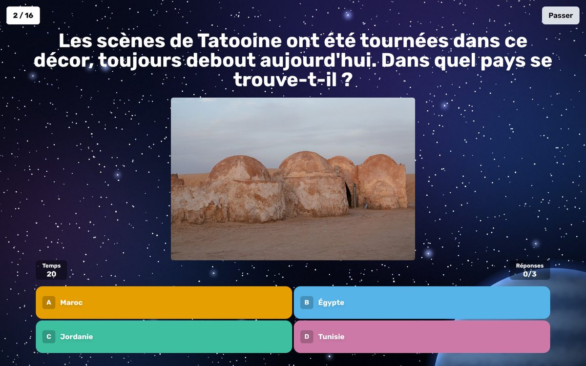
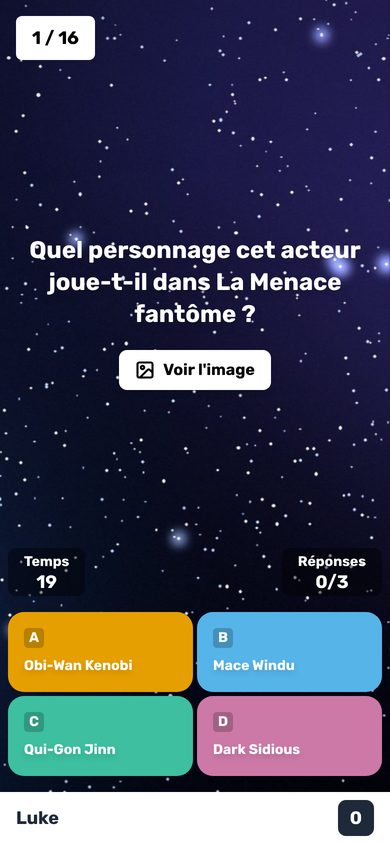
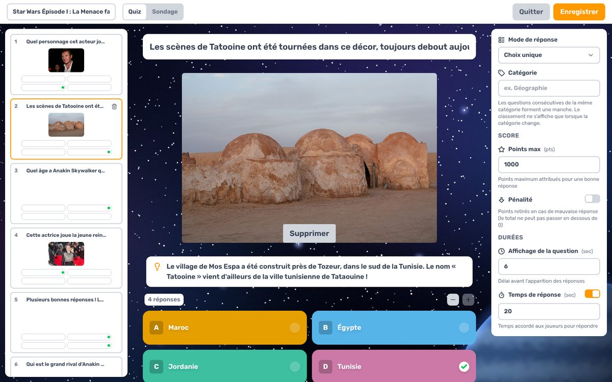

# Quiz Star Wars façon Kahoot

Un jeu de quiz multijoueur en temps réel, façon Kahoot, à héberger soi-même. L'animateur projette les questions sur un grand écran, les joueurs répondent depuis leur téléphone avec un code PIN.

Ce dépôt est un fork de **[Razzia](https://github.com/Ralex91/Razzia)** (anciennement _Rahoot_), un clone open-source de Kahoot sous licence MIT. Tout le moteur de jeu vient de Razzia : pas besoin de réinventer la roue. Ce fork ajoute :

- un quiz d'exemple **Star Wars Épisode I : La Menace fantôme** (35 questions, une photo à chaque question dont les 4 invités de la soirée dans l'univers Star Wars, une anecdote à chaque réponse) ;
- des **gages** : au début de la partie, les joueurs proposent des gages et votent, puis le dernier du classement fait le plus voté ;
- un fond étoilé pour les écrans de jeu ;
- un hébergement gratuit en ligne sur Render, en quelques clics ;
- cette documentation en français.

<p align="center">
  
  
</p>
<p align="center">
  
  
</p>

## Fonctionnalités

- **Parties en temps réel** : code PIN et QR code, les joueurs rejoignent depuis le navigateur de leur téléphone (aucune appli à installer).
- **Éditeur de quiz intégré** : questions à choix unique, à choix multiple ou d'estimation (curseur), 2 à 4 réponses, photos, vidéos et sons, temps de réponse, points, pénalités, manches et explications affichées à la révélation.
- **Classement** après chaque question, **podium** final, historique des résultats.
- Reconnexion des joueurs, verrouillage de la salle, exclusion d'un joueur, avance automatique, mode sondage.
- Interface en français (et en 8 autres langues).

## Démarrage

Trois façons de lancer le jeu : en ligne sur Render (rien à installer), ou sur ton ordinateur avec Docker ou Node.js.

### En ligne, gratuitement (Render)

[Render](https://render.com) héberge le jeu gratuitement et donne une adresse publique : les joueurs peuvent rejoindre depuis n'importe où, sans être sur le même Wi-Fi.

1. Clique sur ce bouton :

   [](https://render.com/deploy?repo=https://github.com/cocobomp/kahoot)

2. Crée un compte Render en te connectant avec GitHub. Render peut demander une carte bancaire pour vérifier le compte ; l'offre gratuite n'est pas facturée.
3. Render affiche le service `quiz-star-wars` : saisis le mot de passe de l'animateur dans `MANAGER_PASSWORD`, puis valide.
4. Attends la fin de la construction (environ 5 minutes). Le jeu est en ligne à l'adresse affichée par Render, du type `https://quiz-star-wars.onrender.com`. L'animateur ouvre cette adresse suivie de `/manager`.

Les limites de l'offre gratuite :

- **Mise en veille** : le serveur s'endort après 15 minutes sans visite, et la visite suivante le réveille en une minute environ. Ouvre la page manager un peu avant la partie.
- **Quiz créés en ligne** : les quiz créés ou modifiés dans l'éditeur, et les photos importées, sont effacés quand le serveur s'endort ou redémarre. Le quiz Star Wars, lui, fait partie du dépôt et reste toujours là. Pour garder un quiz, exporte-le (icône de téléchargement dans l'onglet **Quizz**) et ajoute le fichier JSON dans le dossier `config/quizz` du dépôt sur GitHub (**Add file** > **Upload files**). Render redéploie alors le jeu tout seul avec ton quiz. Si tu utilises des images en ligne (**Ajouter depuis une URL** dans l'éditeur), le fichier JSON suffit ; sinon, ajoute aussi les photos dans `config/media`, sous le même nom.

### Avec Docker (recommandé sur ton ordinateur)

Il faut [Docker Desktop](https://www.docker.com/products/docker-desktop/) (ou Docker + Docker Compose).

```bash
git clone https://github.com/cocobomp/kahoot.git
```

```bash
cd kahoot
```

```bash
cp .env.example .env
```

Ouvre le fichier `.env` et choisis le mot de passe de l'animateur, par exemple `MANAGER_PASSWORD=maitre-yoda`. Puis lance le jeu :

```bash
docker compose up -d --build
```

La première fois, la construction prend quelques minutes. Le jeu tourne ensuite sur le port 3000. Pour l'arrêter : `docker compose down`.

### Sans Docker

Il faut [Node.js 24](https://nodejs.org/) et [pnpm](https://pnpm.io/fr/installation) (`npm install -g pnpm`). Depuis le dossier du dépôt :

```bash
pnpm install
```

```bash
cp .env.example .env
```

Choisis le mot de passe dans `.env` (`MANAGER_PASSWORD=...`), puis :

```bash
pnpm build
```

```bash
pnpm start
```

Au démarrage, la ligne `Network: http://192.168.x.x:3000/` indique l'adresse à utiliser depuis les téléphones.

## Lancer une partie

1. Sur l'ordinateur branché au vidéoprojecteur ou à la télé, ouvre `http://ADRESSE-IP:3000/manager` (voir ci-dessous) et entre le mot de passe.
2. Onglet **Jouer** : choisis **Star Wars Épisode I : La Menace fantôme**, puis **Démarrer la partie**.
3. Les joueurs scannent le QR code, ou vont sur `http://ADRESSE-IP:3000` et tapent le code PIN, puis leur pseudo.
4. Quand tout le monde est là, clique sur **Démarrer**. Ensuite, **Suivant** fait avancer la partie (réponse, classement, question suivante).

L'icône d'engrenage de la salle d'attente donne accès aux réglages : avance automatique, pseudos générés, réponses seules sur les téléphones.

### Connecter les téléphones (important)

Les téléphones doivent être sur **le même Wi-Fi** que l'ordinateur, et la page manager doit être ouverte avec **l'adresse IP de l'ordinateur, pas `localhost`**. L'adresse affichée aux joueurs et le QR code reprennent l'adresse de la page manager : avec `localhost`, les téléphones ne trouveront pas le jeu.

Pour trouver l'adresse IP de l'ordinateur :

| Système | Commande                 | À lire              |
| ------- | ------------------------ | ------------------- |
| Windows | `ipconfig`               | « Adresse IPv4 »    |
| macOS   | `ipconfig getifaddr en0` | l'adresse affichée  |
| Linux   | `hostname -I`            | la première adresse |

Par exemple, si l'adresse est `192.168.1.42`, ouvre `http://192.168.1.42:3000/manager`. Si les téléphones n'arrivent toujours pas à se connecter, autorise le port 3000 dans le pare-feu de l'ordinateur (sous Windows, accepte la demande d'accès « réseaux privés » au premier lancement).

### Jouer à distance

Si les joueurs ne sont pas sur le même réseau, le plus simple est un tunnel Cloudflare gratuit, sans compte. Installe [`cloudflared`](https://developers.cloudflare.com/cloudflare-one/connections/connect-networks/downloads/) (`brew install cloudflared` sur macOS, `winget install --id Cloudflare.cloudflared` sur Windows), puis lance :

```bash
cloudflared tunnel --url http://localhost:3000
```

Il affiche une adresse du type `https://xxxx.trycloudflare.com`. Ouvre `https://xxxx.trycloudflare.com/manager` : le QR code et l'adresse affichée aux joueurs utiliseront cette adresse publique.

Pour une adresse permanente, utilise plutôt [Render](#en-ligne-gratuitement-render). Pour un hébergement sur ton propre serveur (nom de domaine, HTTPS), voir [docs/reverse-proxy.md](docs/reverse-proxy.md) ; sans Docker, ajoute ton nom de domaine à `ALLOWED_HOSTS` dans `.env`.

## Créer ses propres quiz

1. Ouvre `/manager`, onglet **Quizz**, puis **Créer un quizz** (ou l'icône crayon pour modifier un quiz existant, comme celui de Star Wars).
2. Donne un titre au quiz. Pour chaque question :
   - écris la question et 2 à 4 réponses, puis clique sur le rond d'une réponse pour la marquer comme bonne ;
   - choisis le **Mode de réponse** : choix unique, choix multiple (plusieurs bonnes réponses) ou estimation (un nombre à trouver avec un curseur) ;
   - ajoute une photo, une vidéo ou un son dans la zone média : **Importer** envoie un fichier depuis ton ordinateur, **Médiathèque** réutilise un fichier déjà importé, **Ajouter depuis une URL** utilise une image en ligne ;
   - règle le **Temps de réponse**, l'**Affichage de la question** (délai avant l'apparition des réponses), les **Points max** et l'**Explication** affichée quand la réponse est révélée.
3. **Ajouter une question** pour la suivante, puis **Enregistrer**.

Astuces : un « vrai ou faux » est une question à choix unique avec deux réponses ; des points doublés, c'est **Points max** à 2000.

**Gages** : au début de la partie, chaque joueur propose sur son téléphone jusqu'à 3 gages, ou aucun, puis tout le monde vote (chacun coche un ou plusieurs gages, les siens compris). Le plus voté est validé ; en cas d'égalité, il est tiré au sort. À la fin, le podium annonce le gage et le dernier du classement qui doit le faire (ou les derniers, s'ils sont à égalité), et son téléphone le lui rappelle. Dans l'éditeur, le bouton **Gages** active ou coupe cette étape pour le quiz (elle est activée par défaut sur les nouveaux quiz) et permet d'écrire jusqu'à 4 gages de secours, utilisés si les joueurs en proposent moins de deux. L'animateur peut écourter chaque étape avec **Passer**. Le gage de chaque partie apparaît aussi dans l'onglet **Résultats**.

Les quiz sont enregistrés dans `config/quizz/` (un fichier JSON par quiz) et les photos dans `config/media/`. Ces dossiers sont suivis par git : fais un commit pour sauvegarder tes quiz. Tu peux aussi exporter ou importer un quiz en JSON depuis l'onglet **Quizz**. Le format des fichiers est décrit dans [docs/quiz.md](docs/quiz.md).

## Le quiz Star Wars d'exemple

Le fichier [`config/quizz/star-wars-episode-1.json`](config/quizz/star-wars-episode-1.json) contient 35 questions en français :

- 33 questions à choix unique, 1 à choix multiple, 1 estimation au curseur ;
- une photo à chaque question : les quatre invités de la soirée dans l'univers Star Wars (Kilian à la course de modules sur Tatooine, Célien sur Naboo, Fabien sur Coruscant, Corentin pendant le duel contre Dark Maul), acteurs, lieux de tournage, accessoires… ;
- une anecdote affichée à chaque réponse, et une dernière question à points doublés ;
- des gages proposés par les joueurs au début, avec 3 gages de secours (ne pas toucher son téléphone pendant 1 h, 30 min de marche, parler comme Yoda).

Compte environ 35 minutes de jeu. Le quiz se modifie dans l'éditeur comme n'importe quel autre.

## Personnaliser

- **Fond des écrans de jeu** : défini dans [`config/branding/theme.json`](config/branding/theme.json). Supprime le dossier `config/branding/` pour revenir au décor d'origine (une salle de classe).
- **Nom, couleurs, logo, police** : ajoute les champs correspondants dans `theme.json`, voir [docs/branding.md](docs/branding.md).
- **Variables d'environnement** (ports, secret de session) : voir [docs/configuration.md](docs/configuration.md). Sans Docker, `ALLOWED_HOSTS` autorise des noms de domaine supplémentaires (les adresses Codespaces et des tunnels Cloudflare sont déjà acceptées).

## Mettre à jour Razzia

Ce dépôt contient l'historique complet de Razzia. Pour récupérer une nouvelle version (remplace `4.1.0` par la dernière [version publiée](https://github.com/Ralex91/Razzia/tags)) :

```bash
git remote add upstream https://github.com/Ralex91/Razzia.git
```

```bash
git fetch upstream --tags
```

```bash
git merge 4.1.0
```

Ce fork modifie quelques fichiers de Razzia (gages, hébergement, documentation) : en cas de conflit, garde les deux modifications. Relance ensuite `docker compose up -d --build` (ou `pnpm install && pnpm build`). La première commande n'est à faire qu'une fois.

## Crédits et licences

- Moteur de jeu : [Razzia](https://github.com/Ralex91/Razzia) par Ralex91 et ses contributeurs, licence [MIT](LICENSE).
- Fond étoilé : image originale générée pour ce projet.
- Images des invités (`kilian-tatooine.jpg`, `celien-naboo.jpg`, `fabien-coruscant.jpg`, `corentin-maul.jpg`) : générées par l'organisateur de la soirée.
- Photos du quiz : [Wikimedia Commons](https://commons.wikimedia.org/). Elles ont été redimensionnées et leurs métadonnées retirées ; chacune reste sous sa licence d'origine (les versions modifiées d'une photo CC BY-SA doivent garder la même licence). Les captures d'écran de `docs/captures/` contiennent certaines de ces photos.

| Photo                                                               | Sujet                                                                                                                                                                                 | Auteur          | Licence                                                         |
| ------------------------------------------------------------------- | ------------------------------------------------------------------------------------------------------------------------------------------------------------------------------------- | --------------- | --------------------------------------------------------------- |
| [`liam-neeson.jpg`](config/media/liam-neeson.jpg)                   | [Liam Neeson au festival de Toronto 2008](https://commons.wikimedia.org/wiki/File:Liam_Neeson_at_2008_TIFF.jpg)                                                                       | Karen Seto      | [CC BY 2.0](https://creativecommons.org/licenses/by/2.0/)       |
| [`mos-espa-tunisie.jpg`](config/media/mos-espa-tunisie.jpg)         | [Décor de Mos Espa, Ong Jemel (Tunisie)](https://commons.wikimedia.org/wiki/File:Tatooine%28js%295.jpg)                                                                               | Jerzystrzelecki | [CC BY 3.0](https://creativecommons.org/licenses/by/3.0/)       |
| [`natalie-portman.jpg`](config/media/natalie-portman.jpg)           | [Natalie Portman à la Berlinale 2015](https://commons.wikimedia.org/wiki/File:Natalie_Portman_Berlin_2015_3.jpg)                                                                      | Siebbi          | [CC BY-SA 3.0](https://creativecommons.org/licenses/by-sa/3.0/) |
| [`ray-park.jpg`](config/media/ray-park.jpg)                         | [Ray Park en 2012](https://commons.wikimedia.org/wiki/File:Ray_Park_%287281768204%29.jpg)                                                                                             | Gordon Tarpley  | [CC BY 2.0](https://creativecommons.org/licenses/by/2.0/)       |
| [`john-williams.jpg`](config/media/john-williams.jpg)               | [John Williams dirigeant le Boston Pops, 2011](https://commons.wikimedia.org/wiki/File:John_Williams_with_Boston_Pops-1.jpg)                                                          | Chris Devers    | [CC BY-SA 2.0](https://creativecommons.org/licenses/by-sa/2.0/) |
| [`george-lucas.jpg`](config/media/george-lucas.jpg)                 | [George Lucas à la Mostra de Venise 2009](https://commons.wikimedia.org/wiki/File:George_Lucas_66%C3%A8me_Festival_de_Venise_%28Mostra%29_5.jpg)                                      | Nicolas Genin   | [CC BY-SA 2.0](https://creativecommons.org/licenses/by-sa/2.0/) |
| [`anakin-jake-lloyd.jpg`](config/media/anakin-jake-lloyd.jpg)       | [Jake Lloyd](https://commons.wikimedia.org/wiki/File:Jake_Lloyd.jpg)                                                                                                                  | Dwight Stanley  | Domaine public                                                  |
| [`samuel-l-jackson.jpg`](config/media/samuel-l-jackson.jpg)         | [Samuel L. Jackson en 2019](https://commons.wikimedia.org/wiki/File:Samuel_L._Jackson_2019_by_Glenn_Francis.jpg)                                                                      | Glenn Francis   | [CC BY-SA 4.0](https://creativecommons.org/licenses/by-sa/4.0/) |
| [`mos-espa-course.jpg`](config/media/mos-espa-course.jpg)           | [Décor de Mos Espa (Tunisie)](https://commons.wikimedia.org/wiki/File:Ong_Jmel,_Mos_Espa,_Star_Wars_set,_Nefta,_Tunisie_DSC_1991.jpg)                                                 | Habib M'henni   | [CC BY-SA 4.0](https://creativecommons.org/licenses/by-sa/4.0/) |
| [`mos-espa-watto.jpg`](config/media/mos-espa-watto.jpg)             | [Décor de Mos Espa (Tunisie)](https://commons.wikimedia.org/wiki/File:Mos_Espa,_site_du_tournage_de_Starwars,_Tunisie,_20220324_112648.jpg)                                           | Habib M'henni   | [CC BY-SA 4.0](https://creativecommons.org/licenses/by-sa/4.0/) |
| [`mos-espa-boonta.jpg`](config/media/mos-espa-boonta.jpg)           | [Décor de Mos Espa (Tunisie)](https://commons.wikimedia.org/wiki/File:Ong_Jmel,_Mos_Espa,_Star_Wars_set,_Nefta,_Tunisie_DSC_1993.jpg)                                                 | Habib M'henni   | [CC BY-SA 4.0](https://creativecommons.org/licenses/by-sa/4.0/) |
| [`mos-espa-desert.jpg`](config/media/mos-espa-desert.jpg)           | [Décor de Mos Espa (Tunisie)](https://commons.wikimedia.org/wiki/File:Ong_Jmel,_Mos_Espa,_Star_Wars_set,_Nefta,_Tunisie_DSC_1992.jpg)                                                 | Habib M'henni   | [CC BY-SA 4.0](https://creativecommons.org/licenses/by-sa/4.0/) |
| [`mos-espa-evaporateur.jpg`](config/media/mos-espa-evaporateur.jpg) | [Évaporateur du décor de Mos Espa](https://commons.wikimedia.org/wiki/File:Decorado_Star_Wars_en_T%C3%BAnez.jpg)                                                                      | Certo Xornal    | [CC BY 2.0](https://creativecommons.org/licenses/by/2.0/)       |
| [`midi-chloriens.jpg`](config/media/midi-chloriens.jpg)             | [Mitochondries au microscope électronique](https://commons.wikimedia.org/wiki/File:Mitochondria,_mammalian_lung_-_TEM.jpg)                                                            | Louisa Howard   | Domaine public                                                  |
| [`natalie-portman-2.jpg`](config/media/natalie-portman-2.jpg)       | [Natalie Portman à la Berlinale 2015](https://commons.wikimedia.org/wiki/File:Natalie_Portman_Berlin_2015_04.jpg)                                                                     | Siebbi          | [CC BY-SA 3.0](https://creativecommons.org/licenses/by-sa/3.0/) |
| [`natalie-portman-3.jpg`](config/media/natalie-portman-3.jpg)       | [Natalie Portman à la Berlinale 2015 (recadrée)](https://commons.wikimedia.org/wiki/File:Natalie_Portman_Berlin_2015_01.jpg)                                                          | Siebbi          | [CC BY-SA 3.0](https://creativecommons.org/licenses/by-sa/3.0/) |
| [`ksar-hadada.jpg`](config/media/ksar-hadada.jpg)                   | [Ksar Hadada (Tunisie)](https://commons.wikimedia.org/wiki/File:Ksar_Hadada_int%C3%A9rieur.jpg)                                                                                       | Smailtn         | [CC BY-SA 4.0](https://creativecommons.org/licenses/by-sa/4.0/) |
| [`reggia-caserta.jpg`](config/media/reggia-caserta.jpg)             | [Grand escalier du palais royal de Caserte](https://commons.wikimedia.org/wiki/File:Reggia_di_Caserta,_scalone_d%27onore._-_panoramio.jpg)                                            | Carlo Pelagalli | [CC BY-SA 3.0](https://creativecommons.org/licenses/by-sa/3.0/) |
| [`keira-knightley.jpg`](config/media/keira-knightley.jpg)           | [Keira Knightley en 2012](https://commons.wikimedia.org/wiki/File:Keira_Knightley_2012.jpg)                                                                                           | Paul Bird       | [CC BY 2.0](https://creativecommons.org/licenses/by/2.0/)       |
| [`villa-balbianello.jpg`](config/media/villa-balbianello.jpg)       | [Terrasse de la villa del Balbianello](https://commons.wikimedia.org/wiki/File:23VillaBalbianello.jpg)                                                                                | MarkusMark      | [CC BY-SA 3.0](https://creativecommons.org/licenses/by-sa/3.0/) |
| [`lac-de-come.jpg`](config/media/lac-de-come.jpg)                   | [Villa del Balbianello sur le lac de Côme](https://commons.wikimedia.org/wiki/File:Tremezzina_-_Villa_del_Balbianello_-_2024-09-08_16-26-39_007.jpg)                                  | Emibuzz         | [CC BY-SA 4.0](https://creativecommons.org/licenses/by-sa/4.0/) |
| [`hubble.jpg`](config/media/hubble.jpg)                             | [Hubble Ultra Deep Field](https://commons.wikimedia.org/wiki/File:Hubble_ultra_deep_field.jpg)                                                                                        | NASA et ESA     | Domaine public                                                  |
| [`porte-conteneurs.jpg`](config/media/porte-conteneurs.jpg)         | [Porte-conteneurs à San Francisco](<https://commons.wikimedia.org/wiki/File:Container_ships_President_Truman_(IMO_8616283)_and_President_Kennedy_(IMO_8616295)_at_San_Francisco.jpg>) | NOAA            | Domaine public                                                  |
| [`des.jpg`](config/media/des.jpg)                                   | [Dés à six faces](https://commons.wikimedia.org/wiki/File:6sided_dice.jpg)                                                                                                            | Diacritica      | [CC BY-SA 3.0](https://creativecommons.org/licenses/by-sa/3.0/) |
| [`r2-d2.jpg`](config/media/r2-d2.jpg)                               | [R2-D2 exposé au MNACTEC (Terrassa)](<https://commons.wikimedia.org/wiki/File:208_MNACTEC_(Terrassa),_exposici%C3%B3_temporal_Robots,_R2-D2,_de_Star_Wars_(1977).jpg>)                | Enric           | [CC BY-SA 4.0](https://creativecommons.org/licenses/by-sa/4.0/) |
| [`fontaine-yoda.jpg`](config/media/fontaine-yoda.jpg)               | [Fontaine Yoda chez Lucasfilm](https://commons.wikimedia.org/wiki/File:Matt_Busch_at_Lucasfilm.jpg)                                                                                   | PannaDragon     | [CC BY-SA 4.0](https://creativecommons.org/licenses/by-sa/4.0/) |
| [`ahmed-best.jpg`](config/media/ahmed-best.jpg)                     | [Ahmed Best en 2010](<https://commons.wikimedia.org/wiki/File:10.2.10AhmedBestByLuigiNovi_(cropped).jpg>)                                                                             | Luigi Novi      | [CC BY 3.0](https://creativecommons.org/licenses/by/3.0/)       |
| [`ewan-mcgregor.jpg`](config/media/ewan-mcgregor.jpg)               | [Ewan McGregor au New York Comic Con 2023](https://commons.wikimedia.org/wiki/File:Ewan_Mcgregor_NYCC_2023_02.jpg)                                                                    | JaceMerlyn      | [CC BY 4.0](https://creativecommons.org/licenses/by/4.0/)       |
| [`coruscant-pudong.jpg`](config/media/coruscant-pudong.jpg)         | [Pudong (Shanghai) la nuit](https://commons.wikimedia.org/wiki/File:The_skyline_of_Pudong_at_night.jpg)                                                                               | Lloyd Tudor     | [CC BY-SA 4.0](https://creativecommons.org/licenses/by-sa/4.0/) |

Ce quiz est un projet de fan, non officiel, sans lien avec Lucasfilm Ltd. ou The Walt Disney Company. Star Wars est une marque de Lucasfilm Ltd. Kahoot! est une marque de Kahoot! ASA ; ce projet n'est ni affilié à Kahoot ni approuvé par Kahoot.
